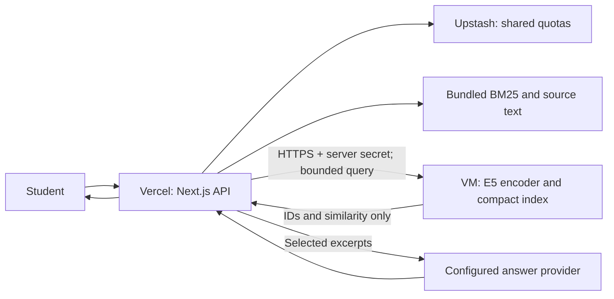

# VidyaPath deployment: exact destinations and next steps

Prepared 14 November 2026. The code, corpus and upload-ready service bundle are local. No cloud account, VM, database, public bucket, DNS record or deployment was created by this work.

## Recommended layout

Use the existing Next.js site on Vercel, a small private E5 retrieval service on a VM, and Upstash for shared AI limits. An external vector database is not required for the present 54,260-document corpus: the supplied service searches a compact normalized vector index and returns IDs. The website resolves those IDs into its own pinned source passages and combines them with BM25. A service outage falls back to local BM25.

Oracle Always Free is a candidate for the VM: the current official limit for Always Free A1 tenancies is 2 OCPUs and 12 GB RAM, subject to monthly allowances, home-region capacity and idle-instance reclamation. Select resources explicitly labelled Always Free; do not assume trial credits or larger shapes remain free. [Oracle limits and availability](https://docs.oracle.com/en-us/iaas/Content/FreeTier/freetier_topic-Always_Free_Resources.htm).



## What goes where

| Item | Destination | Instructions |
| --- | --- | --- |
| Reviewed application/service source, lockfiles, tests and deployment config | Your GitHub repository | Use a reviewed feature branch/PR. Inspect existing changes before staging. |
| `lib/context/chunks.jsonl.gz`, `textbook_chunks.jsonl.gz`, `retrieval_index.json.gz`, both chapter-map `.json.gz` files, `retrieval_manifest.json` | GitHub with the same app commit, then Vercel | These are the actual web runtime artifacts. Commit the matching tracked raw textbook/chapter metadata too so local/prebuild checks stay consistent; raw files are excluded from web functions. |
| `.cache/retrieval-deploy-<release>-<code-version>/` | Retrieval VM, as one directory | Contains only the service code/lockfile and `release/vectors.f32`, `release/rows.json`, `release/semantic_manifest.json`. Use the packager below. |
| E5 model weights | VM's `model-cache/` | Download once with the explicit preparation command. Runtime starts offline and fails if the cache is missing. No API inference fee. |
| Provider keys, Redis credentials, dashboard key, retrieval URL/key | Vercel environment settings | Server-only names. Never put secrets in GitHub, public storage or `NEXT_PUBLIC_` variables. |
| Retrieval shared secret | VM `.env`, and Vercel `RETRIEVAL_SERVICE_KEY` | Generate on the VM; paste directly into the provider environment UI, not into chat. |
| Optional public academic corpus release | Supabase Storage `context/releases/<fingerprint>/` | Optional backup/CDN fallback only; not required for the bundled deployment. See step 7. |

Do not upload the entire `.cache` directory, dataset, `lib/context/images` extraction crops, `.env.local`, runtime feedback/log files, student images or answers. The several-gigabyte extraction crops are offline inputs; no runtime route serves them. The 420 MiB raw JSONL vectors are not needed on Vercel or in the compact service bundle. Keep original local vectors/backups for rebuilding.

## 1. Prepare and verify locally

The expensive extraction/E5 build is already complete. Do not repeat it just to deploy.

```powershell
Set-Location D:\VidyaPath
npm run check:ci
npm run test:retrieval-service
npm run eval:rag:report
npm run build
npm run check:function-sizes

node scripts/export_semantic_release.mjs --apply
node scripts/package_retrieval_service.mjs
```

The exporter converts existing vectors; it does not recompute embeddings, download models or publish anything. It checks the full vector digest, model, dimension, count and source IDs. The packager prints the exact upload-ready directory. A different corpus gets a new release ID; a service code change gets a different bundle suffix.

The current semantic release is `df1e96493cb2447372bbaaf9`: 54,260 vectors, about 79.5 MiB binary data and 4.3 MiB row metadata. The website's compressed corpus is separate. Re-run the exporter/packager after future corpus changes and use the printed paths rather than assuming this ID remains current.

The service's security tests bind localhost. On the Codex Windows sandbox they require approved localhost network access; a normal local terminal or GitHub Actions can run them directly.

## 2. Publish reviewed application changes to GitHub

Review `git status` and `git diff`, including new files. Commit the application fixes, `services/retrieval/`, scripts, docs, service lockfile, new compressed textbook artifact and matching corpus manifest together. Use your normal feature-branch/PR workflow and wait for CI. Do not stage unrelated user changes or run a blind `git add .`.

The 54,260-vector file is intentionally ignored. It is exported into the compact VM bundle instead. Neither GitHub nor Vercel needs the PDF dataset to serve existing chunks.

## 3. Provision the retrieval VM and transfer the bundle

1. Create an eligible Ubuntu ARM VM with the required free allowance/capacity. ONNX Runtime publishes Linux ARM64 CPU support, but the actual VM/container must still be verified. [Supported platforms](https://onnxruntime.ai/docs/get-started/with-javascript/node.html).
2. Install Docker Engine and the Compose plugin using the [official Ubuntu instructions](https://docs.docker.com/engine/install/ubuntu/). Check `docker version` and `docker compose version`.
3. At Oracle's network rules, allow inbound HTTPS 443 and HTTP 80 for certificate issuance. Restrict SSH 22 to your administrator address. Do not open service port 8080 publicly.
4. Allocate an existing domain/subdomain such as `retrieval.yourdomain.example` to the VM's public address. Domain ownership/registration is separate from free compute.
5. Transfer only the directory printed by the packager. Replace the placeholders below; the SSH key stays on your computer:

```powershell
scp -i "C:\path\to\your-ssh-key" -r "D:\VidyaPath\.cache\retrieval-deploy-RELEASE-CODE" ubuntu@YOUR_VM_IP:~/vidyapath-retrieval
```

If the remote folder already exists, transfer a new versioned directory instead of overwriting a live release. Keep one known-good previous bundle for rollback.

## 4. Configure and start the service on the VM

Run these commands in the transferred directory on the Linux VM, not in Windows PowerShell:

```bash
cd ~/vidyapath-retrieval
umask 077
printf 'RETRIEVAL_SERVICE_KEY=%s\n' "$(openssl rand -hex 32)" > .env
mkdir -p model-cache
sudo chown 1000:1000 model-cache
chmod -R a+rX release

docker compose build
docker compose --profile setup run --rm prepare
docker compose up -d retrieval
docker compose ps
curl --fail http://127.0.0.1:8080/health
```

The explicit `prepare` step downloads only the public E5 model. The running service mounts the index and model cache read-only, runs as a non-root user, has bounded concurrent work and never logs search text. It binds through Compose only to loopback. The health response must show the expected model, document count and corpus fingerprint.

Test an authenticated scoped search without placing the key in shell history:

```bash
set -a
. ./.env
set +a
curl --fail --silent --show-error http://127.0.0.1:8080/search \
  -H "Authorization: Bearer $RETRIEVAL_SERVICE_KEY" \
  -H 'Content-Type: application/json' \
  --data '{"query":"Explain acids bases pH and salts","classLevel":10,"subject":"Chemistry","chapterId":"c10-chem-2","topK":6}'
unset RETRIEVAL_SERVICE_KEY
```

Expect IDs/similarity scores, the exact E5 model and matching corpus/vector digests. No source text, student history or provider API keys are stored in this service. Missing/incorrect authorization must return 401.

## 5. Put HTTPS in front of the service

Install Caddy using its [official instructions](https://caddyserver.com/docs/install). Copy `Caddyfile.example` into the active Caddy configuration, replacing the domain with your actual DNS name. Validate and reload using your OS installation's service commands:

```bash
sudo caddy validate --config /etc/caddy/Caddyfile
sudo systemctl reload caddy
curl --fail https://retrieval.YOUR_DOMAIN/health
```

Do not disable certificate verification or expose port 8080. Caddy forwards to loopback; requests to `/search` still require the shared secret. No browser CORS allowance is needed because the caller is the Next.js backend.

## 6. Configure Vercel and deploy a preview

Import/connect the reviewed GitHub repository with the Next.js preset, repository root, Node 22, install command `npm ci`, build command `npm run build`, and the framework's default output directory.

Set these in Vercel's environment settings for the environment being tested:

```dotenv
NEXT_PUBLIC_APP_URL=https://YOUR_ACTUAL_SITE_ORIGIN
DEVELOPER_DASHBOARD_KEY=<separate-random-operator-key-at-least-24-characters>
UPSTASH_REDIS_REST_URL=<your-redis-rest-url>
UPSTASH_REDIS_REST_TOKEN=<your-redis-rest-token>
GEMINI_API_KEY=<usable-server-key-for-generation-and-images>
# Optional configured generation fallbacks:
GROQ_API_KEY=<usable-server-key>

AI_MAX_TOKENS_PER_REQUEST=16000
AI_DAILY_TOKEN_BUDGET_GLOBAL=1000000
AI_PUBLIC_DAILY_REQUESTS_PER_IP=120
AI_ENABLE_RETRIEVAL_LLM=0
AI_ENABLE_NVIDIA_RERANK=0

AI_VECTOR_BACKEND=remote
RETRIEVAL_SERVICE_URL=https://retrieval.YOUR_DOMAIN
RETRIEVAL_SERVICE_KEY=<the-same-value-created-on-the-VM>
```

Do not set `AI_ENABLE_LOCAL_EMBEDDINGS=1` on Vercel. Do not enable the Supabase backend at the same time; no vector SQL migration is needed for this recommended route. The local image cap was corrected to 16,000, but you must set the deployment value separately. Keep provider-side spending controls/free quotas enabled; an application token allowance is not a billing guarantee.

The optional local/hosted injection classifier is a separate service and remains disabled unless deliberately configured and evaluated. Do not point a Vercel environment at `127.0.0.1` for services on your own laptop.

If you want the BM25 pilot first, omit the three remote retrieval settings. The site can serve the bundled corpus before the VM is available. Enable the remote settings only after health/search checks pass. Use separate preview credentials/quotas where feasible; test requests consume the configured shared budgets.

## 7. Optional corpus CDN/storage upload

This is optional. It does not replace the current bundled files or automatically reduce package/memory costs. Create a public academic-corpus bucket named `context` in your selected Supabase project, and verify rights to redistribute its contents. Only the approved compressed corpus/manifest is uploaded.

Keep `SUPABASE_URL` and `SUPABASE_SERVICE_ROLE_KEY` in your local untracked environment file. Then:

```powershell
node scripts/upload_context_to_storage.mjs
node --env-file=.env.local scripts/upload_context_to_storage.mjs --apply
```

Set `CONTEXT_CDN_URL` to the exact immutable release URL printed by the uploader. Its files must match the manifest shipped in the app. The uploader does not upload vectors, PDFs, images, answers or credentials. For these larger files, interruption can require retrying a file; existing identical files can be retried without overwriting a release. [Supabase upload/versioning guidance](https://supabase.com/docs/guides/storage/uploads/standard-uploads).

## 8. Acceptance checks before student rollout

- Open the deployed `/developer` console. Confirm 54,260 corpus chunks/current manifest, expected benchmark fingerprint and the 43 flagged chapters.
- Run the local-only retrieval check for a real chemistry question; verify excerpt text and chapter IDs. This intentionally does not contact the VM.
- Run the public context-pack tester once to exercise the actual remote path. Refresh the console: the remote E5 service should show `ready`, not just configured. Missing/old releases are rejected and fall back to BM25.
- Test valid chapter chat, quiz, flashcards, drills, diagnosis, remediation, revision planning, ungraded paper feedback and a clear question image using the actual provider account. Review answers with subject expertise. These live generation/quota checks have not been certified by local mocks.
- Check unknown chapters, cross-class selections, prompt injections, bogus citations and oversized images. Confirm unauthenticated developer endpoints return 401 and cross-site mutations return 403.
- Temporarily stop the retrieval service and verify BM25 still works. Test Redis protection failure in a preview environment; production AI must pause rather than bypass limits.
- Measure cold starts, memory, latency and a small concurrent-student workload on the actual target. The Windows service smoke measurement is not an Oracle/Vercel SLA. Docker/ARM execution has not been verified here because the Docker daemon was unavailable.
- Fix the failing `c12-eng-1` retrieval case and review coverage before claiming full curriculum support. `c10-eng-6` has no source material, and 26 chapters lack mapped textbook chunks. The chapter page now explains missing source availability; do not fill gaps with fabricated material.

Promote the verified preview only when these checks meet your launch scope. A limited covered-chapter pilot is different from a complete-curriculum launch.

## Updates and rollback

For a new corpus: rebuild/evaluate locally, export/package a new semantic release, start/verify it on the VM, and deploy the matching app artifacts. A brief release mismatch falls back to BM25; it never mixes vector spaces or accepts remote passage text. The service returns IDs only, so all actual evidence remains pinned to the web app's corpus.

For rollback, disable `AI_VECTOR_BACKEND=remote` in the web environment and redeploy to restore BM25-only operation. Restore the previous service bundle and matching Vercel deployment if rolling back the corpus itself. Keep backups outside public buckets. Do not modify a running release in place or delete the only known-good copy.

Remaining manual work: cloud provisioning, DNS/HTTPS, actual deployment, teacher/content review, live provider testing and target-host load/failure checks. All local implementation and export work is reviewable in this repository.

## Additional app fixes completed during this review

- Added the private semantic service and web adapter, release export/packaging, developer health status and contract tests. Remote IDs must match the web corpus and curriculum scope before becoming evidence.
- Compressed textbook deployment data and made postbuild check every page/API trace. Offline PDFs, image crops, embeddings, caches, secrets and runtime feedback are excluded from deployment traces; private runtime JSON is excluded from Docker contexts too. The previous API-only check missed page traces and ignored large untracked crops.
- Fixed chapter-statistics loading to use hash-verified deployment gzip, deduplicate mirrored books, precompute topic evidence and share concurrent cache builds. Local static page generation dropped from 88 seconds with retries to about 15 seconds without retries in the measured builds; this is not a target-host latency guarantee.
- Removed invented fallback paper-year history and frequency labels from chapters without indexed paper-year evidence. Marks/focus topics are labelled heuristic guidance; missing AI source material has a visible unavailable state.
- Corrected the local image budget cap, the developer no-AI tester, uncertainty wording and the misleading claim that the AI was trained only on NCERT.

The build reports a React 18 deprecation warning. Current Next.js 16 builds succeed; plan and test a React 19 migration before upgrading to Next.js 17. That framework migration is separate from the retrieval deployment.

## Verification snapshot: 14 November 2026

- `npm run check:ci`: TypeScript, zero-warning lint and 92 tests passed; one opt-in integration test skipped in the default suite. That integration test was also run explicitly against the actual local E5 service and passed.
- Retrieval service HTTP security contracts passed; 10 Python extraction/identity tests passed. Fresh npm audits of the full app and separate service lockfile reported zero known vulnerabilities.
- Production build and automatic postbuild deployment checks passed: all 48 page/API traces include the required corpus, contain no prohibited offline/private artifacts, and fit the 240 MiB guardrail. Largest measured trace: 72.98 MiB.
- The public production API retrieved through the actual 54,260-vector service; the developer console reported `ready` (227 ms measured remote request). The service's isolated warm query measured 83 ms and roughly 606 MiB process RSS on this Windows machine. These are local observations, not VM performance guarantees.
- Production HTTP checks passed for health, developer authentication, cross-site mutation rejection, source-grounded chemistry retrieval, empty missing-chapter retrieval and current benchmark metadata. Browser/HTTP checks confirmed the missing-source notice and absence of invented exam years/frequency.
- Corpus deployment checks passed; the retrieval benchmark remains 24/25 on a small local-only lexical test set. It does not certify semantic answer accuracy, calculations, OCR, multilingual safety or teacher approval.
- Current upload-ready VM bundle: `D:\VidyaPath\.cache\retrieval-deploy-df1e96493cb2447372bbaaf9-a82a3b2b2835`. Repackage after service/corpus changes; do not reuse this path blindly.

No cloud upload, public deployment, optional database migration or classifier activation was performed. Docker/ARM deployment, real answer-provider behavior and target-host load/failure testing remain unverified. Resolve the 43 coverage review flags (including 26 chapters without mapped textbook chunks) using `INDEXING_PLAN.md`; `c10-eng-6` still has no mapped source and `c12-eng-1` still fails its benchmark case. Source review cannot be replaced by rerunning the same embedding job.

## Clean-checkout build correction: 15 November 2026

Git normalizes the editable textbook JSONL to LF, while the existing hash-pinned gzip payload contains CRLF. The original prebuild comparison incorrectly reported a stale gzip on clean Linux checkouts. The comparison now ignores CRLF/LF differences only; actual content changes and deployed artifact SHA-256 mismatches still fail. Regression tests cover all three cases. No reindexing, recompression or semantic-service release replacement is needed for this fix.

Commit the prebuild fix and its tests before rerunning CI/Vercel. The latest Supabase check reports that preview branching is disabled and skips creation; the recommended VM/BM25 setup does not require a Supabase preview database. Vercel's own deployment log must be checked separately for additional errors if its next build still fails.

Local verification: the committed prebuild was reproduced failing against Git-normalized textbook content, and the fixed version passed against the same content. TypeScript, strict lint and all 95 default tests passed (one opt-in integration skip). Production build and all 48 deployment trace checks passed; largest trace remains 72.98 MiB. The fix is local until committed/pushed; remote CI and Vercel have not rerun with it.
